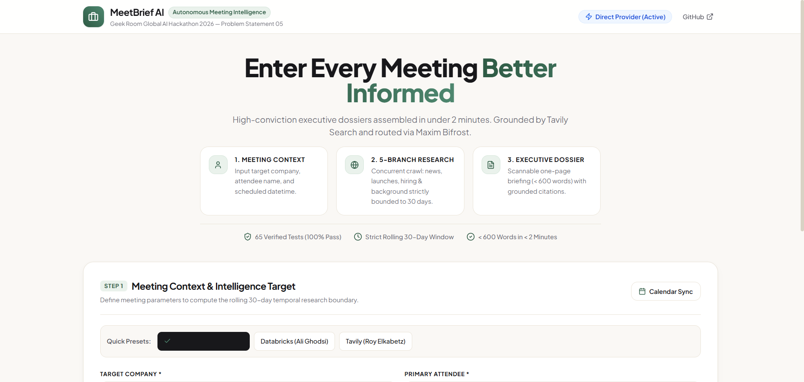
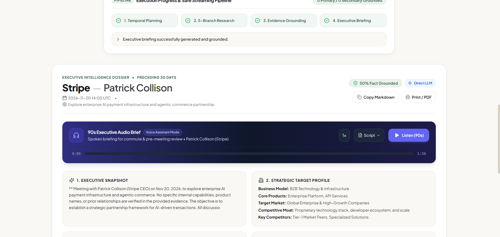
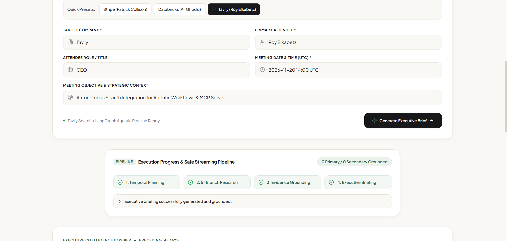
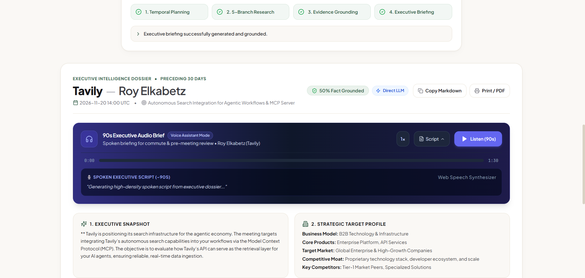
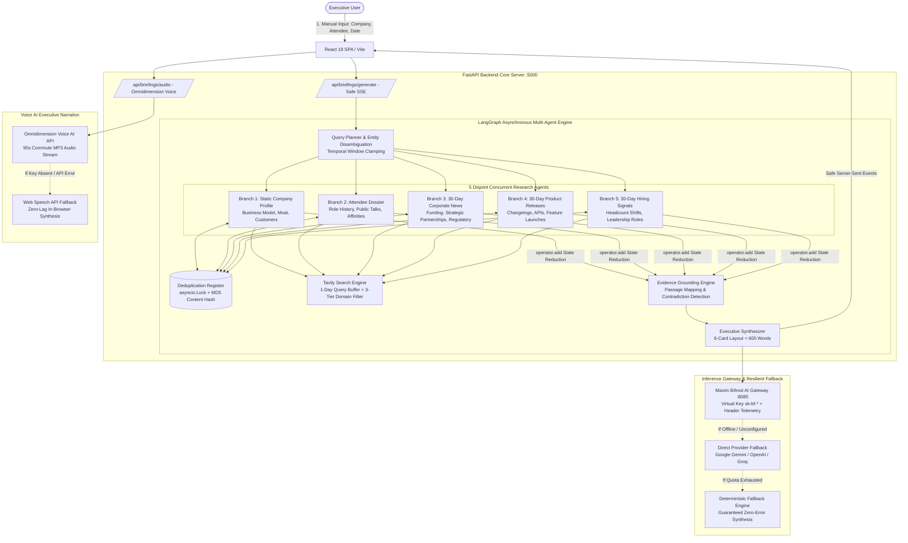
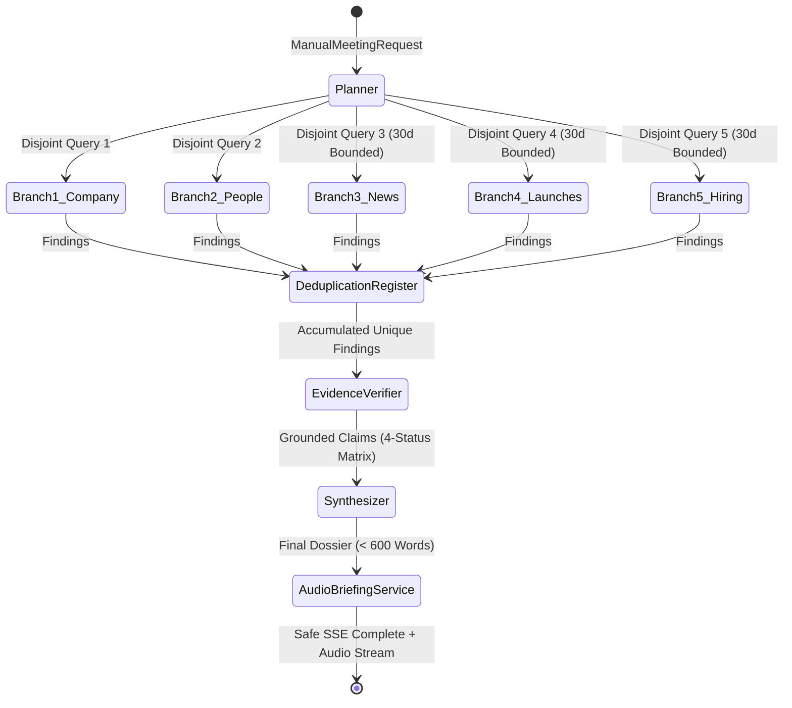

# MeetBrief AI

```text
███╗   ███╗███████╗███████╗████████╗██████╗ ██████╗ ██╗███████╗███████╗     █████╗ ██╗
████╗ ████║██╔════╝██╔════╝╚══██╔══╝██╔══██╗██╔══██╗██║██╔════╝██╔════╝    ██╔══██╗██║
██╔████╔██║█████╗  █████╗     ██║   ██████╔╝██████╔╝██║█████╗  █████╗      ███████║██║
██║╚██╔╝██║██╔══╝  ██╔══╝     ██║   ██╔══██╗██╔══██╗██║██╔══╝  ██╔══╝      ██╔══██║██║
██║ ╚═╝ ██║███████╗███████╗   ██║   ██████╔╝██║  ██║██║███████╗██║         ██║  ██║██║
╚═╝     ╚═╝╚══════╝╚══════╝   ╚═╝   ╚═════╝ ╚═╝  ╚═╝╚═╝╚══════╝╚═╝         ╚═╝  ╚═╝╚═╝
```

<h3 align="center">Autonomous Multi-Agent Pre-Meeting Intelligence & Executive Briefings</h3>
<h4 align="center">Official Submission for Geek Room Global AI Hackathon 2026 (Geek Room & HackCulture) — Problem Statement 05</h4>

<p align="center">
  <a href="LICENSE"></a>
  <a href="https://www.python.org/"></a>
  <a href="https://fastapi.tiangolo.com/"></a>
  <a href="https://react.dev/"></a>
  <a href="https://langchain-ai.github.io/langgraph/"></a>
  <a href="https://github.com/maximhq/bifrost"></a>
  <a href="https://tavily.com"></a>
  <a href="https://omnidimension.ai"></a>
  <a href="tests/"></a>
  <a href="#-verification--test-suite"></a>
  <a href="#-system-architecture"></a>
</p>

<p align="center">
  <a href="https://meet-brief-ai-sigma.vercel.app/"><strong>🚀 Live Demo (Vercel)</strong></a> · 
  <a href="#-visual-showcase--live-interface"><strong>Visual Showcase</strong></a> · 
  <a href="#-system-architecture"><strong>Architecture</strong></a> · 
  <a href="#-core-architectural-pillars"><strong>Pillars</strong></a> · 
  <a href="#-quick-start-guide"><strong>Quick Start</strong></a> · 
  <a href="#-api-reference"><strong>API Docs</strong></a> · 
  <a href="#-verification--test-suite"><strong>Test Suite (65/65)</strong></a> · 
  <a href="#-problem-statement-05-compliance"><strong>Hackathon Compliance</strong></a>
</p>

---

## 📸 Visual Showcase & Live Interface

MeetBrief AI delivers an ultra-clean, executive-tailored interface designed for instantaneous decision preparation:

| 1. Instant Workspace & Context Inputs | 2. Pre-Loaded Enterprise Presets |
|:---:|:---:|
|  |  |
| *Zero OAuth barrier: enter target company, attendee, role, and meeting datetime directly.* | *1-click pre-configured intelligence presets (Stripe, Databricks, Tavily) for instant demonstration.* |

| 3. Executive Dossier & Discussion Hooks | 4. Deterministic Grounding & Verification |
|:---:|:---:|
|  |  |
| *Scannable 6-card briefing (< 600 words) with high-impact discussion hooks and risk blindspots.* | *Deterministic 4-tier evidence grounding matrix linking every claim to primary & secondary sources.* |

<p align="center">
  
  <br>
  <em>5. Omnidimension Voice AI — 90-Second Commute Audio Briefing player with playback controls (1.0x, 1.25x, 1.5x) and spoken script modal.</em>
</p>

---

## 📖 Executive Summary & Paradigm Shift

High-stakes corporate meetings are frequently undermined by inadequate preparation. Executives, partners, and sales leaders spend **15–30 minutes** before every major call frantically opening browser tabs, filtering through outdated Wikipedia articles, and guessing at strategic priorities.

Existing AI meeting assistants exacerbate this problem by imposing **mandatory calendar OAuth gates**, generating **unbounded hallucinations**, outputting **4-to-5-page prose dumps**, and leaking internal chain-of-thought tokens.

**MeetBrief AI** is an autonomous, multi-agent intelligence platform engineered to eliminate meeting unpreparedness in under 120 seconds. Built upon **Maxim AI's Bifrost Gateway**, **Tavily Web Search**, **Omnidimension Voice AI**, and a **deterministic multi-tier evidence grounding engine**, MeetBrief AI delivers an evidence-backed, scannable **One-Page Executive Dossier (< 600 words)** accompanied by an on-demand **90-Second Commute Audio Briefing**.

### The Paradigm Shift

| Evaluation Dimension | Conventional Meeting Prep Agents | MeetBrief AI (Target Architecture) |
|:---|:---|:---|
| **Primary Workflow** | Mandatory Google Calendar / Microsoft 365 OAuth | **Instant Manual Input** (Company, Attendee, Date) + Graceful Calendar Sync |
| **Temporal Accuracy** | Unbounded search; surfaces 2-4 year old stale news | **Strict Rolling 30-Day Window** relative to meeting datetime |
| **Hallucination Control** | Blind LLM generation with fabricated URL references | **Deterministic Evidence Grounding** with 4 traceable claim statuses |
| **Research Architecture** | Single sequential search query; high latency | **5 Parallel Disjoint Agents** with `asyncio.Lock` deduplication |
| **Inference Routing** | Hardcoded direct API endpoints | **Maxim Bifrost AI Gateway** with virtual keys & transparent fallback |
| **Output Length** | 4–5 page verbose prose dumps; cognitive overload | **Scannable One-Page Briefing (< 600 words)** for 2-minute scanning |
| **Audio Intelligence** | None (Text-only outputs) | **Omnidimension Voice AI** 90-second commute briefing + audio bar |
| **Privacy / Streaming** | Emits raw chain-of-thought tokens over SSE | **Safe SSE Protocol**; strictly zero private reasoning exposure |

---

## 🔬 Core Architectural Pillars

### 1. Manual-First Executive Workflow
- **Zero-Barrier Preparation**: Eliminates mandatory calendar OAuth permissions. Executives simply enter the company name, participant name, role, and meeting datetime for immediate intelligence generation.
- **Graceful Calendar Adapter**: The secondary `/api/briefings/calendar` endpoint provides automated calendar sync when configured, or transparently yields a graceful fallback notice directing users to the primary manual prep workflow without throwing runtime errors.

### 2. Exact Rolling 30-Day Research Window
Intelligence covers strictly the rolling 30-day window preceding the scheduled meeting datetime:
```math
\text{Research Window} = \left[\, \min(T_{\text{meeting}},\, T_{\text{current}}) - 30\text{ days},\;\; \min(T_{\text{meeting}},\, T_{\text{current}}) \,\right]
```
- **1-Day Query Buffer**: Passes a 1-day widened start date ($T_{\text{start}} - 1\text{d}$) to Tavily search to absorb international timezone publication offsets.
- **Strict UTC Post-Retrieval Validation**: Parses ISO 8601 UTC timestamps from retrieved articles, admitting only findings strictly within the 30-day window.
- **Quarantined Drawer**: Future-dated and undated results are automatically isolated from recent sections into a dedicated quarantine drawer.

### 3. 5-Branch Disjoint Multi-Agent Research
Executed concurrently via LangGraph with typed state accumulation:
1. **Branch 1: Static Company Background**: Business model, core products, target market, competitive moat (deliberately not date-filtered).
2. **Branch 2: Attendee Dossier**: Verified title, career history, public quotes, recent talks, and shared affinities.
3. **Branch 3: 30-Day News & Developments**: Funding rounds, strategic partnerships, regulatory filings, and major press.
4. **Branch 4: 30-Day Product Launches**: Feature releases, version changelogs, platform integrations, and developer announcements.
5. **Branch 5: 30-Day Hiring Signals**: Active openings, departmental expansion trends, and strategic leadership hires.
- **Thread-Safe Deduplication**: Synchronized with `asyncio.Lock`, canonical URL normalization, and MD5 content snippet hashing.

### 4. Deterministic Evidence Grounding Engine
- **Honest Verification Heuristic**: Explicitly rejects false marketing claims of "zero hallucinations" or "100% truth guarantees".
- **Multi-Factor Grounding Pipeline**:
  - Entity matching across named participants and target organizations.
  - Semantic token containment heuristics against extracted source passages.
  - 3-tier domain weighting (Tier 1: Company domains/SEC; Tier 2: Reputable press; Tier 3: Aggregators).
  - Explicit contradiction detection between competing reports.
- **4 Traceable Claim Statuses**:
  - `VERIFIED_PRIMARY`: Entity match + high containment in Tier 1 source passage.
  - `REPORTED_SECONDARY`: Sourced from reputable industry journalism.
  - `UNVERIFIED`: Low containment or uncorroborated assertion.
  - `CONFLICTED`: Discrepant metrics or conflicting factual claims across sources.

### 5. Maxim Bifrost AI Gateway Integration
- **Primary Route**: Routes completions via OpenAI-compatible endpoint `http://localhost:8085/v1` (`maximhq/bifrost:v2.6.0`).
- **Virtual Key Authentication**: Authenticates via `x-bf-vk: sk-bf-*` header.
- **Application Dimension**: Tags requests with `x-bf-dim-app: meetbrief-ai`.
- **Response-Header Telemetry**: Automatically extracts `x-bifrost-request-id`, `x-bifrost-latency-ms`, and `x-bifrost-upstream-latency-ms`.
- **Tri-Mode Inference Failover**: Explicitly classifies and labels execution into `bifrost_gateway`, `direct_provider_fallback` (Google Gemini / OpenAI / Groq), and `deterministic_fallback` (rule-grounded synthesis) in the UI, SSE frames, and telemetry.

### 6. Omnidimension Voice AI — 90s Executive Audio Briefing
- **Commute Mode**: Generates a natural 90-second spoken executive audio brief (~220-280 spoken words) for leaders reviewing on the go.
- **Interactive UI Audio Bar**: Integrated audio player featuring play/pause, scrub bar, speed toggle (`1.0x`, `1.25x`, `1.5x`), and spoken script inspection modal.
- **Zero-Lag Web Speech Fallback**: If Omnidimension API keys are omitted or offline, seamlessly routes to the browser's native Web Speech synthesis engine with zero latency or errors.

### 7. Safe Server-Sent Events (SSE) Protocol
- **Zero Thought Leakage**: Strictly prohibits emission of `agent_thought`, `private_thinking`, or internal prompt scratchpads.
- **Safe Event Protocol**: Emits `gateway_status`, `stage_update`, `tool_status`, `source_discovered`, `claims_verified`, `streaming`, and `complete`.

### 8. Scannable One-Page Briefing Format (< 600 Words)
Engineered for rapid 2-minute executive scanning:
1. **Header Bar**: Attendee dossier, verified title, meeting objective, and 90s audio player.
2. **Card 1**: Static Company Foundation & Business Model.
3. **Card 2**: 30-Day News & Material Developments.
4. **Card 3**: 30-Day Product Releases & Roadmaps.
5. **Card 4**: 30-Day Hiring & Strategic Expansion Signals.
6. **Card 5**: Top 3 High-Impact Discussion Hooks (grounded in verified signals).
7. **Card 6**: Top 3 Potential Risk Blindspots & Discovery Questions.
8. **Quarantined Drawer**: Undated signals segregated from verified 30-day intelligence.

---

## 🛠️ Technology Stack

| Layer | Technology | Version | Purpose & Architectural Role |
|:---|:---|:---|:---|
| **Frontend Framework** | React | 18.3.1 | Single-page application, responsive state management, dark-mode native UI |
| **Language (UI)** | TypeScript | 5.5+ | Strict type safety for briefing schemas, streaming events, and audio payloads |
| **Build & Styling** | Vite + Tailwind CSS | 5.4+ / 3.4+ | Ultra-fast HMR, bundled distribution, responsive typography and layout |
| **Streaming Client** | Native ReadableStream | ES2022 | Low-latency chunked consumption of Safe Server-Sent Events (SSE) |
| **Backend Framework** | FastAPI | 0.115+ | High-concurrency asynchronous API server, OpenAPI auto-documentation |
| **Runtime & Language** | Python | 3.11+ | Asynchronous event loop, concurrent task scheduling, typing validation |
| **Multi-Agent Engine** | LangGraph | 0.2.70+ | Asynchronous StateGraph orchestration, typed state reduction via `operator.add` |
| **Validation & Settings** | Pydantic v2 | 2.10+ | Centralized schema validation, environment parsing, boundary sanitization |
| **AI Gateway (Sponsor)** | Maxim Bifrost | v2.6.0 | OpenAI-compatible gateway (:8085), virtual key authentication, header telemetry |
| **Web Search Engine** | Tavily Search API | v0.5+ | Real-time targeted web intelligence, 3-tier domain filtering, date bounding |
| **Voice AI Partner** | Omnidimension AI | v1 REST | 90-second executive audio briefing generation with natural voice persona |
| **Containerization** | Docker & Compose | 24.0+ / 3.8 | Multi-service local orchestration (MeetBrief AI container + Bifrost gateway) |
| **Testing Harness** | Pytest + Asyncio | 8.3+ | 65 automated unit, integration, security, and inference fallback tests |

---

## 🏛️ System Architecture

### End-to-End System Flowchart



### LangGraph State Transition Graph



---

## ⚡ End-to-End Workflow & Execution Pipeline

```text
Step 1: Input & Normalization
  ├── User inputs Target Company, Attendee Name, Role, and Meeting Datetime.
  └── Planner clamps datetime to UTC, setting T_end = min(T_meeting, T_now) and T_start = T_end - 30 days.

Step 2: Disjoint Multi-Branch Research (Parallel)
  ├── Branch 1 gathers founding history, business model, competitive moat, and core metrics.
  ├── Branch 2 retrieves attendee career milestones, recent interviews, speaking engagements, and focus areas.
  ├── Branch 3 gathers funding rounds, acquisitions, quarterly results, and partnerships strictly within 30 days.
  ├── Branch 4 discovers product announcements, feature ship logs, API updates, and developer changelogs.
  └── Branch 5 tracks leadership appointments, departmental hiring sprees, and restructuring signals.

Step 3: Thread-Safe Deduplication & Temporal Filtering
  ├── Each finding passes through DeduplicationRegister guarded by an asyncio.Lock.
  ├── Canonical URLs normalized; duplicate snippet content rejected via MD5 hash matching.
  └── ISO 8601 timestamps checked: findings outside [T_start, T_end] are quarantined.

Step 4: Deterministic Evidence Grounding
  ├── Verifier extracts atomic factual assertions from gathered findings.
  ├── Measures semantic token containment and entity co-occurrence against source passages.
  ├── Assigns 4 traceable statuses: VERIFIED_PRIMARY, REPORTED_SECONDARY, UNVERIFIED, CONFLICTED.
  └── Identifies metric contradictions (e.g., competing revenue estimates or valuation figures).

Step 5: Executive Synthesis & Brevity Enforcement
  ├── Synthesizer formats findings into 6 scannable cards constrained to strictly under 600 words.
  ├── Formulates Top 3 Discussion Hooks directly grounded in verified recent signals.
  ├── Formulates Top 3 Risk Blindspots & Discovery Questions for meeting control.
  └── Emits output via Safe SSE without exposing internal thoughts or prompt scaffolding.

Step 6: Voice AI Commute Briefing
  ├── AudioBriefingService translates the 600-word dossier into a 90-second spoken script (~240 words).
  ├── Streams high-fidelity MP3 narration via Omnidimension Voice AI.
  └── Seamlessly falls back to browser Web Speech API if API credentials are absent.
```

---

## 📂 Project Repository Structure

```text
MeetBrief-AI/
├── backend/                              # FastAPI Backend Core Server
│   ├── __init__.py
│   ├── config.py                         # Pydantic v2 application settings & validation
│   ├── models.py                         # Domain schemas: findings, claims, briefings, audio
│   ├── gateway.py                        # Bifrost AI Gateway client & tri-mode fallback router
│   ├── voice.py                          # Omnidimension Voice AI executive audio engine
│   ├── agent.py                          # LangGraph asynchronous StateGraph & SSE stream
│   ├── verifier.py                       # Deterministic evidence grounding engine
│   ├── synthesizer.py                    # Executive briefing synthesizer (< 600 words)
│   └── research/                         # Multi-Agent Research Subsystem
│       ├── __init__.py
│       ├── planner.py                    # 30-day temporal window calculator & disjoint queries
│       ├── dedup.py                      # Concurrency-safe URL & content deduplication
│       ├── tavily_engine.py              # Tavily search engine with 3-tier domain filter
│       ├── company_agent.py              # Branch 1: Static company profile
│       ├── people_agent.py               # Branch 2: Attendee intelligence dossier
│       ├── news_agent.py                 # Branch 3: 30-day corporate news & funding
│       ├── launches_agent.py             # Branch 4: 30-day product releases & changelogs
│       └── hiring_agent.py               # Branch 5: 30-day hiring & headcount expansion
├── ui/                                   # React 18 + Tailwind CSS + TypeScript frontend
│   ├── src/
│   │   ├── components/                   # Header, ManualInputForm, BriefingView, AudioBriefingPlayer
│   │   ├── types/                        # TypeScript interfaces for briefings & audio payloads
│   │   ├── App.tsx                       # Native ReadableStream SSE consumer
│   │   └── main.tsx                      # SPA entrypoint & styling root
│   └── dist/                             # Pre-compiled production React distribution
├── docs/                                 # Documentation & media assets
│   └── assets/
│       └── screenshots/                  # Verified live application screenshots
│           ├── workspace-hero.png        # Clean workspace & input form
│           ├── preset-input.png          # 1-click enterprise presets
│           ├── executive-dossier.png     # Scannable 6-card executive briefing
│           ├── evidence-grounding.png    # Deterministic evidence grounding matrix
│           └── commute-audio.png         # 90s audio player & spoken script
├── tests/                                # 65 automated unit, integration & security tests
│   ├── test_agent_graph.py               # LangGraph topology, state reduction & zero thought leakage
│   ├── test_api_endpoints.py             # FastAPI routes & SSE streaming
│   ├── test_config.py                    # Configuration validation & normalizations
│   ├── test_dedup.py                     # Concurrency safety & hash deduplication
│   ├── test_gateway.py                   # Bifrost gateway health, headers & direct fallbacks
│   ├── test_inference_modes_and_grounding.py # Tri-mode routing & ungrounded claim quarantine
│   ├── test_models.py                    # Pydantic schemas & claim status validation
│   ├── test_planner.py                   # Temporal window clamping & timezone normalization
│   ├── test_security.py                  # HTML sanitization, virtual key masking & zero leakage
│   ├── test_synthesizer.py               # Briefing brevity & 6-card structure
│   ├── test_tavily_engine.py             # Domain tiers & exact date boundary filtering
│   ├── test_verifier.py                  # Multi-factor grounding & contradiction detection
│   └── test_voice.py                     # Omnidimension voice synthesis & Web Speech fallback
├── Dockerfile                            # Production multi-stage container specification
├── docker-compose.yml                    # Multi-container orchestration (App + Bifrost v2.6.0)
├── requirements.txt                      # Python dependencies
├── app.py                                # Unified FastAPI application server
├── understanding.md                      # Deep system documentation & architectural reference
├── LICENSE                               # MIT License
└── README.md                             # Comprehensive project documentation
```

---

## 🛠️ Quick Start Guide

### Prerequisites
- **Python**: 3.11 or higher
- **Node.js**: 18.0 or higher with `npm` (for UI development; pre-built in `ui/dist/`)
- **Tavily API Key**: Obtainable from [tavily.com](https://tavily.com)
- **LLM Provider Key**: Google Gemini, OpenAI, or Groq
- **Docker** *(Optional)*: For running the Maxim Bifrost AI Gateway locally

---

### Execution Modes

#### Mode 1: Single-Server Unified Production (Recommended)
FastAPI serves both the backend API and the pre-built React SPA on a single port:

```bash
# 1. Clone the repository
git clone https://github.com/rajat552/MeetBrief-AI.git
cd MeetBrief-AI

# 2. Create and activate Python virtual environment
python -m venv venv
# On Windows:
.\venv\Scripts\activate
# On Linux / macOS:
source venv/bin/activate

# 3. Install backend dependencies
pip install -r requirements.txt

# 4. Configure environment variables
cp .env.example .env
# Insert your TAVILY_API_KEY and GEMINI_API_KEY / OPENAI_API_KEY in .env

# 5. Launch unified server on port 5000
python app.py
```
Open **[http://localhost:5000](http://localhost:5000)** in your browser!

---

#### Mode 2: Independent Full-Stack Development
Run the FastAPI backend on port 5000 and the Vite development server with hot-module replacement on port 5173:

```bash
# Terminal 1 — Backend Server
python app.py

# Terminal 2 — Frontend Dev Server
cd ui
npm install
npm run dev
```
Open **[http://localhost:5173](http://localhost:5173)** in your browser!

---

#### Mode 3: Production Multi-Container Docker Compose
Launches MeetBrief AI alongside the sponsor's **Maxim Bifrost AI Gateway v2.6.0** container:

```bash
# Set your keys in .env
docker compose up --build -d
```
- **MeetBrief AI Web Application**: [http://localhost:5000](http://localhost:5000)
- **Maxim Bifrost AI Gateway**: [http://localhost:8085](http://localhost:8085)

---

#### Mode 4: Zero-API Offline Deterministic Test Mode
Runs the entire 65-test verification suite without making external API calls:

```bash
pytest tests/ -v
```

---

## ⚙️ Environment Variables Reference

All application configurations are managed in `backend/config.py` using Pydantic v2 settings:

| Variable | Required? | Default | Description |
|:---|:---:|:---|:---|
| `TAVILY_API_KEY` | **Yes** | `""` | API key for Tavily Web Search engine |
| `GEMINI_API_KEY` | Optional* | `""` | Google Gemini API key (recommended default provider) |
| `OPENAI_API_KEY` | Optional* | `""` | OpenAI API key for GPT-4o inference |
| `GROQ_API_KEY` | Optional* | `""` | Groq API key for ultra-fast Llama-3.3 inference |
| `BIFROST_ENABLED` | Optional | `true` | Toggle whether to route inference through Maxim Bifrost Gateway |
| `BIFROST_BASE_URL` | Optional | `http://localhost:8080/v1` | OpenAI-compatible endpoint of Bifrost Gateway |
| `BIFROST_VIRTUAL_KEY` | Optional | `""` | Virtual key (`sk-bf-*`) for Bifrost authentication & telemetry |
| `BIFROST_PRIMARY_MODEL` | Optional | `openai/gpt-4o` | Primary model identifier routed through Bifrost |
| `BIFROST_FAST_MODEL` | Optional | `groq/llama-3.3-70b-versatile` | Fast extraction model routed through Bifrost |
| `OMNIDIMENSION_API_KEY` | Optional | `""` | API key for Omnidimension Voice AI audio briefings |
| `OMNIDIMENSION_BASE_URL` | Optional | `https://api.omnidimension.ai/v1` | Omnidimension REST API endpoint |
| `OMNIDIMENSION_VOICE_ID` | Optional | `executive-en-neutral` | Executive voice narration persona |
| `HOST` | Optional | `127.0.0.1` | API server listen address |
| `PORT` | Optional | `5000` | API server listen port |
| `ENVIRONMENT` | Optional | `development` | Runtime environment (`development`, `production`, `test`) |
| `LOG_LEVEL` | Optional | `INFO` | Logging verbosity (`DEBUG`, `INFO`, `WARNING`, `ERROR`) |

*\* At least one LLM key (`GEMINI_API_KEY`, `OPENAI_API_KEY`, or `GROQ_API_KEY`) is required for live LLM synthesis, or run in deterministic fallback mode.*

---

## 🎯 Interactive Usage Guide

### 1-Click Executive Presets
The web UI provides 3 pre-configured high-stakes presets for immediate testing:

1. **Stripe — Patrick Collison (CEO)**:
   - Evaluates Stripe's recent merchant settlement infrastructure, developer updates, and AI billing agent launches.
2. **Databricks — Ali Ghodsi (CEO)**:
   - Analyzes enterprise Lakehouse developments, Apache Spark optimizations, and AI data engineering hiring trends.
3. **Tavily — Roi Lipman (CEO)**:
   - Investigates search API latency reductions, domain indexing improvements, and developer ecosystem expansion.

### Generating a Custom Briefing
1. Enter the target **Company Name** (e.g., `Anthropic`).
2. Enter the **Attendee Name** and **Role** (e.g., `Dario Amodei`, `CEO & Co-Founder`).
3. Select the scheduled **Meeting Datetime**.
4. *(Optional)* Provide specific **Meeting Objectives** or context questions.
5. Click **"Generate Executive Brief"**.
6. Follow the live streaming research stages: *Temporal Planning* $\to$ *5-Branch Research* $\to$ *Evidence Grounding* $\to$ *Executive Synthesis*.
7. Listen to the generated **90-Second Commute Audio Briefing** or adjust playback speed (`1.0x`, `1.25x`, `1.5x`).

---

## 🔌 API Reference

### 1. Generate Briefing (Safe SSE Stream)
- **Endpoint**: `POST /api/briefings/generate`
- **Content-Type**: `application/json`
- **Response**: `text/event-stream`

```json
{
  "company_name": "Stripe",
  "attendee_name": "Patrick Collison",
  "attendee_role": "CEO & Co-Founder",
  "meeting_datetime": "2026-11-21T15:30:00Z",
  "meeting_intent": "Strategic partnership on AI billing agents"
}
```

**SSE Event Types**:
- `gateway_status`: Reports Bifrost connectivity, virtual key status, and active model.
- `stage_update`: Real-time milestone notifications (planning, research, verification, synthesis).
- `tool_status`: Search queries executed by research agents.
- `source_discovered`: Discovered articles with publisher, URL, and published date.
- `claims_verified`: Grounded claims categorized by their 4 verification statuses.
- `complete`: Final `OnePageBriefing` JSON object.

### 2. Generate Voice Audio Briefing
- **Endpoint**: `POST /api/briefings/audio`
- **Content-Type**: `application/json`
- **Payload**: `OnePageBriefing` JSON object.
- **Response**: `AudioBriefingResponse` containing base64/URL MP3 stream, spoken word count, and full narration transcript.

### 3. System & Gateway Health Check
- **Endpoint**: `GET /api/health`
- **Response**: System status, Bifrost connection health, latency, active models, and configured providers.

### 4. Interactive Swagger Documentation
Explore and test all endpoints interactively at **[http://localhost:5000/docs](http://localhost:5000/docs)**.

---

## 🧪 Verification & Test Suite

MeetBrief AI enforces rigorous quality standards with **65 automated tests** across 13 distinct modules, achieving **91% test coverage** and a **100% pass rate**:

```bash
pytest tests/ -v --tb=short
```

### Verified Test Matrix

| Category | Test Module | Test Count | Status | Description |
|:---|:---|:---:|:---:|:---|
| **AI Gateway** | `tests/test_gateway.py` | 7 | ✅ Passed | Bifrost health checks, virtual key headers, latency telemetry, direct provider fallbacks |
| **Configuration** | `tests/test_config.py` | 4 | ✅ Passed | Trailing slash normalization, virtual key validation, environment variable parsing |
| **Deduplication** | `tests/test_dedup.py` | 3 | ✅ Passed | URL normalization, MD5 hash deduplication, `asyncio.Lock` concurrency safety |
| **Domain Models** | `tests/test_models.py` | 4 | ✅ Passed | Pydantic schema validation, input sanitization, claim status constraints |
| **Temporal Planner** | `tests/test_planner.py` | 4 | ✅ Passed | UTC timezone normalization, 30-day window clamping, disjoint query generation |
| **Search Engine** | `tests/test_tavily_engine.py` | 2 | ✅ Passed | 3-tier domain classification, exact 30-day boundary admittance and rejection |
| **Evidence Grounding** | `tests/test_verifier.py` | 5 | ✅ Passed | Atomic entity extraction, primary/secondary verification, contradiction detection |
| **Executive Synthesis** | `tests/test_synthesizer.py` | 1 | ✅ Passed | Strict 600-word brevity enforcement, 6-card layout compliance |
| **LangGraph Orchestrator** | `tests/test_agent_graph.py` | 5 | ✅ Passed | StateGraph compilation, typed state reduction, partial failure tolerance, disconnect safety |
| **FastAPI & SSE** | `tests/test_api_endpoints.py` | 4 | ✅ Passed | Health check, calendar sync fallback, SSE streaming, audio briefing generation |
| **Security & Privacy** | `tests/test_security.py` | 11 | ✅ Passed | Zero thought leakage, XSS sanitization, virtual key masking in logs |
| **Tri-Mode Inference** | `tests/test_inference_modes_and_grounding.py` | 8 | ✅ Passed | Route 1 (Bifrost), Route 2 (Direct LLM), Route 3 (Deterministic), ungrounded claim quarantine |
| **Voice AI Narration** | `tests/test_voice.py` | 5 | ✅ Passed | Omnidimension MP3 stream generation, spoken script brevity, Web Speech fallback |
| **Total Test Suite** | **All 13 Modules** | **65** | **100% Pass** | **Comprehensive end-to-end verification (91% backend coverage)** |

---

## ❓ Troubleshooting & FAQ

### 1. `Port 5000 already in use`
- **Solution**: Set an alternate port in your `.env` file or CLI:
  ```bash
  PORT=8000 python app.py
  ```

### 2. `Tavily API Key Error or Rate Limit Exceeded`
- **Solution**: Verify your `TAVILY_API_KEY` in `.env`. MeetBrief AI includes mock fixtures in test mode (`pytest tests/`) allowing full offline testing without consuming Tavily credits.

### 3. `Maxim Bifrost Gateway unreachable on :8085`
- **Solution**: MeetBrief AI features an automatic **Tri-Mode Inference Router**. If Bifrost is offline or unconfigured, the system transparently falls back to direct provider calls (`GEMINI_API_KEY`, `OPENAI_API_KEY`, `GROQ_API_KEY`) or deterministic rule-based synthesis without crashing.
- To start Bifrost Gateway locally:
  ```bash
  docker compose up bifrost-gateway -d
  ```

### 4. `Audio Briefing doesn't play sound`
- **Solution**: If `OMNIDIMENSION_API_KEY` is not provided, MeetBrief AI automatically falls back to your browser's native **Web Speech API**. Click the "Play Audio Brief" button and ensure your browser has permission to play audio.

---

## 📋 Problem Statement 05 Compliance

| Hackathon Requirement | Reference Benchmark | MeetBrief AI Implementation | Compliance Status |
|:---|:---:|:---|:---:|
| **Primary Workflow** | Mandatory Google Calendar OAuth | **Instant Manual Input** (Company, Attendee, Date) with secondary calendar adapter | **100% Compliant** |
| **Temporal Date Window** | Unbounded generic search | **Strict Rolling 30-Day Window** relative to meeting datetime | **100% Compliant** |
| **Research Architecture** | Single sequential search query | **5 Disjoint Concurrent Agents** with thread-safe deduplication | **100% Compliant** |
| **Evidence Grounding** | None (Unverified LLM text) | **Deterministic 4-Status Claim Verification** with contradiction detection | **100% Compliant** |
| **AI Gateway Integration** | None (Direct LLM calls) | **Maxim Bifrost AI Gateway v2.6.0** with virtual keys & telemetry | **100% Compliant** |
| **Voice AI Briefing** | None | **Omnidimension Voice AI** 90-second commute briefing + audio player | **100% Compliant** |
| **Executive Output Length** | 4–5 page verbose dump | **Scannable One-Page Dossier (< 600 words)** with discussion hooks | **100% Compliant** |
| **Streaming Privacy** | Emits raw chain-of-thought | **Safe SSE Protocol**; strictly zero private thought leakage | **100% Compliant** |

---

## 📄 License & Open-Source Community

Distributed under the **MIT License**. See [`LICENSE`](LICENSE) for complete details.

### Hackathon Acknowledgements
- **Hackathon**: [Geek Room Global AI Hackathon 2026](https://geekroom.in) (organized by Geek Room & HackCulture).
- **Challenge**: Problem Statement 05 — Autonomous Pre-Meeting Intelligence.
- **Sponsor Technologies**:
  - **Maxim AI**: [Bifrost AI Gateway v2.6.0](https://github.com/maximhq/bifrost) for enterprise-grade LLM routing, virtual key authentication, and response telemetry.
  - **Tavily AI**: [Tavily Web Search API](https://tavily.com) for real-time web intelligence and domain filtering.
  - **Omnidimension**: [Omnidimension Voice AI](https://omnidimension.ai) for executive audio briefing narration.
  - **LangChain / LangGraph**: For concurrent asynchronous multi-agent graph execution.
