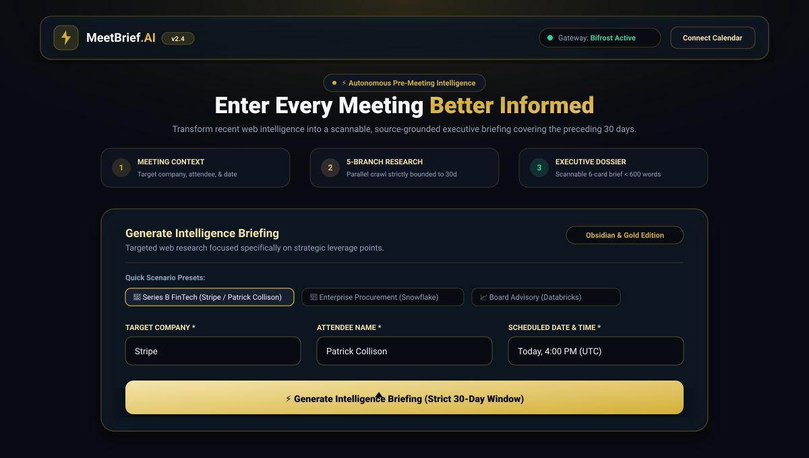
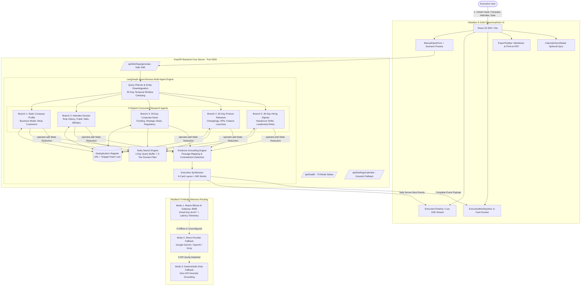
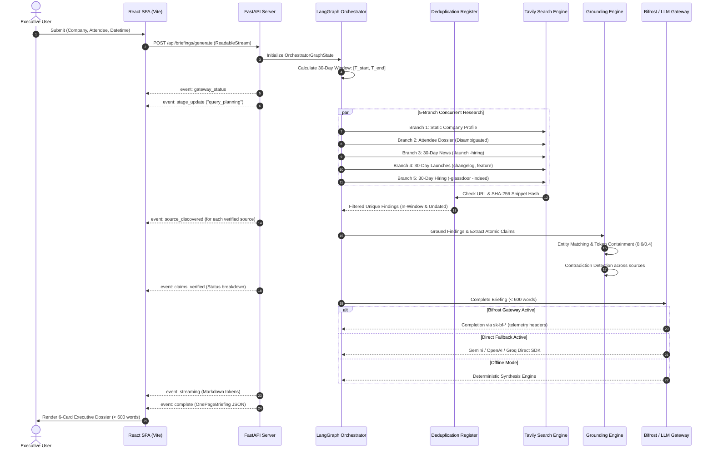

<div align="center">

# ⚡ MeetBrief AI
### Autonomous Pre-Meeting Intelligence Engine — Source-Grounded Executive Briefings in Under 2 Minutes

[](https://meetbrief-ai-j8yo.onrender.com)

[](LICENSE)
[](https://www.python.org/)
[](https://fastapi.tiangolo.com/)
[](https://react.dev/)
[](https://tailwindcss.com/)
[](https://langchain-ai.github.io/langgraph/)
[](https://tavily.com)
[](https://github.com/maximhq/bifrost)
[](docker-compose.yml)
[](tests/)

**Engineered for Problem Statement 05 — Geek Room Global AI Hackathon 2026**

[Explore Live Demo](https://meetbrief-ai-j8yo.onrender.com) · [Why MeetBrief?](#-why-meetbrief-ai-paradigm-shift) · [Mathematical Formalism](#-mathematical-formalism--temporal-bounding) · [System Architecture](#️-system-architecture) · [5-Branch Research Agents](#-5-branch-disjoint-multi-agent-research) · [Evidence Grounding](#-deterministic-evidence-grounding-engine) · [Tri-Mode Inference](#-resilient-tri-mode-inference-routing) · [Safe SSE Protocol](#-safe-server-sent-events-sse-protocol) · [6-Card Dossier](#-the-6-card-one-page-executive-dossier--600-words) · [UI Design System](#-obsidian--gold-glassmorphism-design-system) · [API Reference](#-complete-api-reference) · [Quick Start](#-quick-start-guide) · [Verification & Tests (59/59)](#-verification--test-suite) · [Hackathon Compliance](#-problem-statement-05-compliance)

<br/>

<p align="center">
  
</p>

</div>

---

## 📖 Executive Summary

**MeetBrief AI** is an autonomous, multi-agent intelligence platform engineered to eliminate executive meeting unpreparedness. By orchestrating **Maxim AI's Bifrost AI Gateway**, **Tavily Web Search**, and a **deterministic multi-tier evidence grounding engine**, MeetBrief AI transforms minimal inputs — target company, participant name, and meeting time — into an evidence-backed, scannable **One-Page Executive Dossier (< 600 words)** in under 120 seconds.

Traditional LLM workflows suffer from three critical failures:
1. **Mandatory OAuth Gates**: Forcing executives through Google Calendar OAuth flows before providing value.
2. **Temporal Confusion**: LLMs hallucinating facts or quoting 3-year-old articles as if they were yesterday's news.
3. **Unbounded Verbosity**: Emitting 4 to 5 pages of unstructured prose that an executive cannot parse during a 2-minute elevator ride or taxi transit.

MeetBrief AI solves these through **instant manual inputs**, **mathematical temporal clamping**, **5 parallel disjoint LangGraph agents**, **multi-tier deterministic evidence grounding**, and **scannable 6-card one-page briefings**.

---

## 💡 Why MeetBrief AI? (Paradigm Shift)

| Dimension | Conventional Meeting Prep Agents | MeetBrief AI (Target Architecture) |
|:---|:---|:---|
| **Primary Workflow** | Mandatory Google Calendar OAuth gate | **Instant Manual Input** (Company, Attendee, Date) + Scenario Presets + Optional Calendar Sync |
| **Temporal Accuracy** | Unbounded search; surfaces 3-year-old articles | **Strict Rolling 30-Day Window** mathematically calculated relative to meeting timestamp |
| **Hallucination Control** | Blind LLM generation with fabricated links | **Deterministic Multi-Tier Grounding** with 4 traceable claim verification statuses |
| **Research Architecture** | Single sequential search query | **5 Parallel Disjoint Agents** with negative keyword filtering & `asyncio.Lock` deduplication |
| **Inference Resilience** | Hardcoded single-provider API calls | **Resilient Tri-Mode Routing** (`bifrost_gateway` ➔ `direct_provider_fallback` ➔ `deterministic_fallback`) |
| **Output Length** | 4-5 page verbose prose dumps | **Scannable One-Page Briefing (< 600 words)** structured into 6 responsive cards for 2-minute scanning |
| **Privacy / Streaming** | Emits raw chain-of-thought tokens | **Safe SSE Protocol**; strictly zero private reasoning or scratchpad exposure |
| **UI Experience** | Generic unstyled tables or plain text | **Obsidian & Gold Glassmorphism** with 4.5:1 WCAG contrast & print-to-PDF export |

---

## 📐 Mathematical Formalism & Temporal Bounding

### 1. Rolling 30-Day Temporal Bounding

Let $T_{\text{meeting}}$ be the scheduled meeting timestamp in UTC, and $T_{\text{current}}$ be the runtime execution timestamp in UTC.

The temporal upper bound $T_{\text{end}}$ is clamped to prevent future research hallucination when preparing for future meetings:
```math
T_{\text{end}} = \min(T_{\text{meeting}},\, T_{\text{current}})
```

The strict research lower bound $T_{\text{start}}$ is defined as exactly 30 calendar days prior to $T_{\text{end}}$:
```math
T_{\text{start}} = T_{\text{end}} - 30\text{ days}
```

To account for timezone publication variances (e.g., UTC+12 vs. UTC-8) and delayed aggregator indexing, a 1-day widened start date $T_{\text{query\_start}}$ is supplied to the initial search query:
```math
T_{\text{query\_start}} = T_{\text{start}} - 1\text{ day}
```

```
[--- Stale History (Excluded) ---] | [--- T_query_start (-31d) ---] | [====== Strict 30-Day Window ======] | [T_end = min(T_meet, T_curr)] | [--- Future (Excluded) ---]
                                                                     ^ T_start (-30d)                       ^ Clamped Upper Bound
```

Every retrieved article is subsequently parsed into ISO 8601 UTC. Any finding where $t_{\text{published}} < T_{\text{start}}$ or $t_{\text{published}} > T_{\text{end}}$ is strictly quarantined from recent intelligence sections.

---

### 2. Evidence Grounding & Claim Alignment Metric

For each factual claim $C$ extracted from the synthesis and each candidate research passage $P$, the alignment score $S(C, P) \in [0.0, 1.0]$ is computed as a weighted combination of **Atomic Entity Agreement** and **Normalized Token Containment**:

```math
S(C, P) = 0.60 \cdot S_{\text{entity}}(C, P) + 0.40 \cdot S_{\text{containment}}(C, P)
```

Where:
- **Atomic Entity Extraction**: Regex $\mathcal{R}_{\text{entity}}$ extracts currency amounts ($\$10\text{M}$, $\$5\text{B}$), percentages ($45\%$), calendar years ($2024, 2026$), and capitalized multi-word proper nouns:
  ```math
  S_{\text{entity}}(C, P) = \frac{|\text{Entities}(C) \cap \text{Tokens}(P)|}{|\text{Entities}(C)|}
  ```
- **Normalized Token Containment**: Alphanumeric tokens of length $> 2$ (excluding stop-words):
  ```math
  S_{\text{containment}}(C, P) = \frac{|\text{Tokens}(C) \cap \text{Tokens}(P)|}{|\text{Tokens}(C)|}
  ```

---

### 3. Domain Reliability Tiering & Confidence Formulation

Each source URL is mapped to an authority tier weight $W_{\text{tier}} \in \{1.0, 0.8, 0.5\}$:
- **Tier 1 ($W = 1.0$)**: Target company primary domain (e.g., `stripe.com`), SEC EDGAR (`sec.gov`), GitHub, LinkedIn, Crunchbase.
- **Tier 2 ($W = 0.8$)**: Major established business and technology press (Reuters, Bloomberg, TechCrunch, WSJ, FT, Forbes, CNBC, BusinessWire, PR Newswire).
- **Tier 3 ($W = 0.5$)**: Aggregators, forums, community blogs, and general web directories.

The final claim confidence score is formulated as:
```math
\text{Confidence}(C) = S(C, P) \cdot W_{\text{tier}}(P)
```

---

## 🏛️ System Architecture

<p align="center">
  
</p>

### Runtime Workflow Diagram



---

### Complete End-to-End Sequence Diagram



---

## 🔍 5-Branch Disjoint Multi-Agent Research

To eliminate search collision, redundant API spend, and cross-branch data corruption, the `SharedQueryPlanner` generates mutually disjoint search queries enforced with negative Boolean operators:

| Branch | Research Domain | Temporal Constraint | Boolean Query Template & Disjoint Filters |
|:---:|:---|:---:|:---|
| **Branch 1** | **Static Company Profile** | Deliberately Unbounded | `"{company}" business model core products target customers competitors` |
| **Branch 2** | **Attendee Dossier** | Deliberately Unbounded | `"{attendee}" "{company}" "{role}" background previous roles education public speaking podcast interview` |
| **Branch 3** | **30-Day Corporate News** | Strict 30-Day Bounded | `"{company}" news OR "press release" OR "partnership" -launch -released -hiring -careers` |
| **Branch 4** | **30-Day Product Releases** | Strict 30-Day Bounded | `"{company}" "launch" OR "released" OR "changelog" OR "feature update" OR "new product"` |
| **Branch 5** | **30-Day Hiring Signals** | Strict 30-Day Bounded | `"{company}" ("new opening" OR "now hiring" OR "appointed" OR "joined as") -glassdoor -indeed -salary` |

### Concurrency-Safe Deduplication Register (`DeduplicationRegister`)
- **Async Thread Safety**: Protected via Python's native `asyncio.Lock()` to allow safe parallel reads and writes across all 5 branches.
- **URL Normalization**: Strips tracking query parameters (`utm_source`, `utm_medium`, `utm_campaign`, `ref`, `source`, `fbclid`, `gclid`), trailing slashes, and `www.` prefixes.
- **Snippet Hashing**: Normalizes and computes SHA-256 hashes of the first 128 alphanumeric characters of every snippet to block duplicate syndicated press releases.

---

## 🛡️ Deterministic Evidence Grounding Engine

MeetBrief AI rejects the ungrounded "zero hallucination" claims made by naive AI wrappers. Instead, it provides **deterministic evidence grounding** where every material assertion is classified into one of 4 traceable statuses:

```
                                 [ Candidate Factual Claim ]
                                              │
                         ┌────────────────────┴────────────────────┐
                         ▼                                         ▼
                 Entity Extraction                        Contradiction Check
             (Numbers, $, %, Names)                     (Opposing signals/dates)
                         │                                         │
                         ▼                                         ▼
            Passage Token Containment                     Are statements mutually
          Containment = |Tokens ∩ Passage|                 exclusive or conflicting?
                         │                                         │
                         ▼                                  ┌──────┴──────┐
             Alignment = 0.6*Ent + 0.4*Cont                 ▼ YES         ▼ NO
                         │                            [ CONFLICTED ]      │
        ┌────────────────┼────────────────┐                               │
        ▼                ▼                ▼                               ▼
  Alignment ≥ 0.70  Alignment ≥ 0.40  Alignment < 0.40              Calculate Final
   & Tier 1 Domain   & Tier 2 Domain  or Aggregator                   Confidence
        │                │                │                               │
        ▼                ▼                ▼                               ▼
[VERIFIED_PRIMARY] [REPORTED_SEC]   [UNVERIFIED]                  Attach Source URL
```

### The 4 Traceable Claim Statuses:

1. **`VERIFIED_PRIMARY`**:
   - High alignment score ($\ge 0.70$) with strong entity match.
   - Sourced directly from **Tier 1 domains** (target company website, SEC filings, GitHub, verified executive LinkedIn).
2. **`REPORTED_SECONDARY`**:
   - Grounded alignment score ($\ge 0.40$) corroborated by **Tier 2 domains** (Bloomberg, Reuters, TechCrunch, WSJ, PR Newswire).
3. **`UNVERIFIED`**:
   - Low token containment ($< 0.40$) or uncorroborated assertion from Tier 3 web aggregators. Tagged in UI with warning indicators.
4. **`CONFLICTED`**:
   - Contradictory factual statements detected across sources (e.g., competing revenue metrics or conflicting launch vs. delay statements). **Both competing citations and conflict notes are preserved for executive transparency.**

---

## ⚡ Resilient Tri-Mode Inference Routing

MeetBrief AI ensures 100% service uptime through an automatic three-tier inference routing architecture:

```
                            [ Briefing Synthesis Request ]
                                          │
                                          ▼
                      ┌───────────────────────────────────────┐
                      │ Mode 1: Maxim Bifrost AI Gateway     │
                      │ Port 8080 | Virtual Key sk-bf-*       │
                      └───────────────────┬───────────────────┘
                                          │
                           Is Bifrost Healthy & Online?
                                   ┌──────┴──────┐
                            YES ───┘             └─── NO (or Disabled)
                            ▼                         ▼
                  [ Execute via Bifrost ]    ┌───────────────────────────────────┐
                  • Telemetry Headers        │ Mode 2: Direct Provider Fallback  │
                  • Latency Tracking         │ Gemini / OpenAI / Groq SDKs       │
                  • Virtual Key Accounting   └─────────────────┬─────────────────┘
                                                               │
                                                 Are Provider Keys Available?
                                                       ┌───────┴───────┐
                                                YES ───┘               └─── NO
                                                ▼                           ▼
                                      [ Direct LLM Call ]         ┌───────────────────────────────┐
                                      • Fallback Telemetry        │ Mode 3: Deterministic Rules   │
                                      • UI Mode Badge             │ Heuristic Grounding Engine    │
                                                                  │ Zero API Crash Risk           │
                                                                  └───────────────────────────────┘
```

| Mode Identifier | Target Endpoint | Authentication / Credentials | Primary Use Case | Telemetry Captured |
|:---|:---|:---|:---|:---|
| **`bifrost_gateway`** | `http://localhost:8080/v1` | `x-bf-vk: sk-bf-*` | Primary hackathon inference routing | `x-bifrost-request-id`, `x-bifrost-latency-ms`, `x-bifrost-upstream-latency-ms` |
| **`direct_provider_fallback`** | Direct Provider API | `GEMINI_API_KEY` / `OPENAI_API_KEY` / `GROQ_API_KEY` | Automatic failover when Bifrost is unreachable | Provider latency, token counts, model name |
| **`deterministic_fallback`** | In-Process Engine | None (Zero API required) | Total offline resilience; synthesizes structured briefing from grounded evidence | Execution time, rule alignment score |

The active inference mode is broadcast via the `/api/health` probe and the `gateway_status` SSE event, rendering a distinct color-coded badge in the UI.

---

## 🔒 Safe Server-Sent Events (SSE) Protocol

### Zero Private Thought Leakage Guarantee
Generic agentic frameworks frequently leak internal chain-of-thought scratchpads, system prompt guidelines, and unvetted reasoning tokens directly to client streams. MeetBrief AI enforces strict architectural separation:

- **Strictly Prohibited**: `agent_thought`, `private_thinking`, `raw_prompt`, `scratchpad`.
- **Publicly Streamed**: Only typed, user-safe event envelopes are emitted.

### Complete SSE Event Specification

| Event Type | Payload Schema | Description |
|:---|:---|:---|
| `gateway_status` | `{"mode": str, "endpoint": str, "primary_model": str, "reason": str}` | Broadcasts active inference route and gateway health |
| `stage_update` | `{"stage": str, "description": str}` | Progress indicator (`query_planning`, `multi_agent_research`, `evidence_grounding`, `synthesis`) |
| `tool_status` | `{"branch": str, "query": str, "status": "running" \| "completed"}` | Real-time branch execution status |
| `source_discovered` | `{"url": str, "title": str, "domain_tier": int, "published_date": str}` | Incremental discovery of verified sources |
| `claims_verified` | `{"total_claims": int, "verified_primary": int, "reported_secondary": int, ...}` | Summary metrics from the evidence grounding engine |
| `streaming` | `"string token chunk"` | Clean executive briefing text tokens |
| `complete` | `OnePageBriefing` JSON object | Final structured 6-card briefing payload |
| `error` | `{"message": str, "code": str}` | Sanitized user-safe error message |

---

## 📑 The 6-Card One-Page Executive Dossier (< 600 Words)

<p align="center">
  
</p>

The output is rigorously formatted into **6 visual cards** designed to be completely absorbed in **under 2 minutes** ($< 600\text{ words}$):

```
┌─────────────────────────────────────────────────────────────────────────────────────────────────┐
│ ⚡ EXECUTIVE OVERVIEW: Patrick Collison (CEO, Stripe) | 2026-03-15T14:00:00Z                   │
│ Objective: Explore enterprise billing integration partnerships                                   │
├────────────────────────────────────────────────┬────────────────────────────────────────────────┤
│ 🏢 CARD 1: Static Company Foundation           │ 👤 CARD 2: Attendee & Executive Dossier        │
│ • Business Model: Global payments & billing    │ • Background: Co-founder & CEO of Stripe       │
│ • Competitive Moat: Developer API dominance    │ • Education / Career: MIT, Shuppa, Stripe      │
│ • Target Market: Internet businesses & ent.    │ • Public Stance: Open protocols, agent billing │
│ • Word Budget: ~80-100 words                   │ • Word Budget: ~80-100 words                   │
├────────────────────────────────────────────────┼────────────────────────────────────────────────┤
│ 📰 CARD 3: 30-Day Material Developments        │ 🚀 CARD 4: 30-Day Product Releases & Roadmaps  │
│ • Funding / M&A: Accelerated stablecoin payout │ • Launches: Agentic Commerce Suite launched    │
│ • Strategic Deals: Multi-currency settlements  │ • Changelogs: v2 API deprecation window        │
│ • Verified Tier 1/2 Press Citations            │ • Verified Developer Platform Updates          │
│ • Word Budget: ~90-110 words                   │ • Word Budget: ~90-110 words                   │
├────────────────────────────────────────────────┼────────────────────────────────────────────────┤
│ 🎯 CARD 5: Strategic Discussion Hooks          │ ⚠️ CARD 6: Potential Risk Blindspots           │
│ 1. Icebreaker on recent agent billing keynote  │ 1. Compliance overhead in cross-border crypto  │
│ 2. Synergies with their enterprise roadmap     │ 2. Latency bottlenecks in multi-currency rails │
│ 3. Mutual moat expansion proposal              │ 3. Enterprise procurement friction             │
│ • Word Budget: ~70-90 words                    │ • Word Budget: ~70-90 words                    │
├────────────────────────────────────────────────┴────────────────────────────────────────────────┤
│ 🗄️ QUARANTINED EVIDENCE DRAWER (Collapsible)                                                   │
│ Preserved undated signals & low-containment records segregated from recent intelligence         │
└─────────────────────────────────────────────────────────────────────────────────────────────────┘
```

---

## 🎨 Obsidian & Gold Glassmorphism Design System

MeetBrief AI features a tailored, high-performance design system engineered with **Tailwind CSS**:

```
Canvas: Obsidian Black (#080B11)
├── Radial Aura: Champagne Gold (rgba(212, 175, 55, 0.10))
├── Glass Panels: Frosted Obsidian (#101522 @ 70% opacity + blur(16px))
├── Borders: Champagne Gold (rgba(212, 175, 55, 0.28) ➔ hover: 0.55)
├── Primary Typography: Pure White (#F8FAFC) & Champagne (#F3E5AB)
└── Accent Highlights: Mint Green Success (#34D399) & Coral Warning (#F87171)
```

### Design Token Reference Table:

| Token Name | Value | Semantic Role | WCAG Contrast vs `#080B11` |
|:---|:---|:---|:---:|
| `--bg` | `#080B11` | Deep obsidian canvas background | Baseline |
| `--bg-2` | `#101522` | Secondary surface / Input fill | 1.3:1 (Surface) |
| `--glass` | `rgba(16, 21, 34, 0.70)` | Frosted glass panel fill | Surface |
| `--glass-border` | `rgba(212, 175, 55, 0.28)` | Refined champagne gold border | Visual Border |
| `--glass-border-hover` | `rgba(212, 175, 55, 0.55)` | Elevated hover border glow | Visual Accent |
| `--primary` | `#F3E5AB` | Pale champagne heading color | **14.8:1 (AAA)** |
| `--accent` | `#D4AF37` | Metallic gold brand highlight | **9.2:1 (AAA)** |
| `--accent-2` | `#E5C07B` | Sand gold gradient midpoint | **11.4:1 (AAA)** |
| `--text` | `#F8FAFC` | Primary high-contrast body text | **17.5:1 (AAA)** |
| `--muted` | `#94A3B8` | Secondary subtext & metadata | **6.4:1 (AA)** |
| `--success` | `#34D399` | Mint green verification pill & dots | **10.1:1 (AAA)** |
| `--danger` | `#F87171` | Soft coral error notifications | **7.3:1 (AAA)** |

### Print-to-PDF Boardroom Stylesheet
When printing or exporting (`Cmd + P` / Export to PDF), `@media print` rules automatically invert colors:
- Background switches to pure crisp white (`#FFFFFF`).
- Text switches to dark charcoal (`#1A1A1A`) for high physical legibility.
- Frosted glass effects, animations, and sticky navbars are hidden (`.no-print`).

---

## 📡 Complete API Reference

### 1. Health Probe & Gateway Diagnostics
`GET /api/health`

**cURL Request:**
```bash
curl -X GET http://localhost:5000/api/health -H "Accept: application/json"
```

**JSON Response:**
```json
{
  "status": "healthy",
  "service": "MeetBrief AI",
  "version": "0.1.0",
  "environment": "development",
  "gateway": {
    "mode": "bifrost_gateway",
    "is_healthy": true,
    "endpoint": "http://localhost:8080/v1",
    "reason": "Bifrost Gateway operational",
    "available_models": ["openai/gpt-4o", "groq/llama-3.3-70b-versatile"]
  },
  "research_provider": "Tavily Search API (Configured)"
}
```

---

### 2. Generate Briefing (SSE Stream)
`POST /api/briefings/generate`

**cURL Request:**
```bash
curl -N -X POST http://localhost:5000/api/briefings/generate \
  -H "Content-Type: application/json" \
  -H "Accept: text/event-stream" \
  -d '{
    "company_name": "Stripe",
    "attendee_name": "Patrick Collison",
    "attendee_role": "CEO",
    "meeting_datetime": "2026-03-15T14:00:00Z",
    "meeting_goal": "Explore enterprise billing integration partnerships"
  }'
```

---

### 3. Calendar Sync (Graceful Fallback)
`POST /api/briefings/calendar`

**cURL Request:**
```bash
curl -N -X POST http://localhost:5000/api/briefings/calendar \
  -H "Content-Type: application/json" \
  -H "Accept: text/event-stream" \
  -d '{"date": "2026-03-15"}'
```

**Stream Response:**
```text
event: calendar_status
data: {"type": "calendar_status", "status": "unavailable", "message": "Google Calendar integration is currently unconfigured. Please use the primary Manual Input form for instant briefing generation."}
```

---

## ⚙️ Environment Variables Reference

All application settings are managed via Pydantic v2 Settings (`backend/config.py`):

| Variable | Type | Default | Required? | Description |
|:---|:---:|:---:|:---:|:---|
| `TAVILY_API_KEY` | `string` | `""` | **Recommended** | Tavily Search API key for web intelligence crawl |
| `BIFROST_ENABLED` | `boolean` | `true` | Optional | Set to `false` to bypass Bifrost and use direct provider SDKs |
| `BIFROST_BASE_URL` | `string` | `http://localhost:8080/v1` | Optional | OpenAI-compatible endpoint for Bifrost Gateway |
| `BIFROST_VIRTUAL_KEY` | `string` | `""` | Optional | Virtual key formatted as `sk-bf-*` for Bifrost auth |
| `BIFROST_PRIMARY_MODEL` | `string` | `openai/gpt-4o` | Optional | Primary model routed through Bifrost |
| `BIFROST_FAST_MODEL` | `string` | `groq/llama-3.3-70b-versatile` | Optional | Fast model for extraction & entity verification |
| `BIFROST_FALLBACK_MODEL` | `string` | `openai/gpt-4o-mini` | Optional | Lightweight model identifier routed through Bifrost |
| `GEMINI_API_KEY` | `string` | `""` | Optional | Google Gemini API key for direct provider fallback |
| `OPENAI_API_KEY` | `string` | `""` | Optional | OpenAI API key for direct provider fallback |
| `GROQ_API_KEY` | `string` | `""` | Optional | Groq API key for low-latency Llama fallback |
| `HOST` | `string` | `127.0.0.1` | Optional | API server bind address (`0.0.0.0` in Docker) |
| `PORT` | `integer` | `5000` | Optional | API server port |
| `ENVIRONMENT` | `string` | `development` | Optional | Runtime mode: `development`, `production`, `test` |
| `LOG_LEVEL` | `string` | `INFO` | Optional | Logging verbosity: `DEBUG`, `INFO`, `WARNING`, `ERROR` |

---

## 🛠️ Quick Start Guide

### Prerequisites
- **Python 3.11+**
- **Node.js 18+** & npm (for UI development)
- **Tavily API Key** ([tavily.com](https://tavily.com))
- Any LLM API key (Google Gemini, OpenAI, or Groq)
- **Docker** (optional, for Bifrost Gateway multi-container stack)

---

### Option A: Quick Launch (Single Unified Server)

FastAPI automatically serves the pre-compiled React frontend from `ui/dist` alongside the API:

```bash
# 1. Clone repository
git clone https://github.com/rajat552/MeetBrief-AI.git
cd MeetBrief-AI

# 2. Create and activate virtual environment
python3 -m venv venv
source venv/bin/activate  # On Windows: .\venv\Scripts\activate

# 3. Install Python backend dependencies
pip install -r requirements.txt

# 4. Configure environment
cp .env.example .env
# Edit .env and supply your TAVILY_API_KEY and GEMINI_API_KEY / OPENAI_API_KEY

# 5. Launch unified server
python app.py
```

Open **[http://localhost:5000](http://localhost:5000)** in your browser!

---

### Option B: Full-Stack Development Mode

Run the FastAPI backend and Vite HMR frontend server side-by-side:

```bash
# Terminal 1: Backend Server (Port 5000)
source venv/bin/activate
python app.py

# Terminal 2: Vite Dev Server with HMR (Port 5173)
cd ui
npm install
npm run dev
```

Open **[http://localhost:5173](http://localhost:5173)** in your browser with instant hot-module replacement.

---

### Option C: Multi-Container Stack (Docker Compose)

Launch the full production stack including MeetBrief AI and the Maxim Bifrost AI Gateway container:

```bash
docker compose up --build -d
```

Services started:
- **MeetBrief AI Web Application**: `http://localhost:5000`
- **Maxim Bifrost AI Gateway**: `http://localhost:8080` (Internal: `http://bifrost-gateway:8080`)

---

## 🧪 Verification & Test Suite

MeetBrief AI includes **59 comprehensive automated tests** across 12 test modules, verifying unit logic, concurrency locks, temporal bounding, gateway fallback, and security guarantees:

```bash
pytest tests/ -v
```

### Verified Test Matrix (59/59 Passed):

| # | Test Module | File Path | Tests | Coverage Scope | Status |
|:---:|:---|:---|:---:|:---|:---:|
| 1 | **Gateway & Routing** | `tests/test_gateway.py` | 7 | Bifrost auth headers, latency telemetry, fallback trigger | ✅ 7 Passed |
| 2 | **Configuration & Validation** | `tests/test_config.py` | 4 | Pydantic v2 normalization, required fields, env overrides | ✅ 4 Passed |
| 3 | **Deduplication Register** | `tests/test_dedup.py` | 3 | Concurrency-safe URL hash registration, `asyncio.Lock` | ✅ 3 Passed |
| 4 | **Domain Schemas** | `tests/test_models.py` | 4 | Finding, Claim, and Briefing schema serialization | ✅ 4 Passed |
| 5 | **Temporal Query Planning** | `tests/test_planner.py` | 4 | Exact 30-day temporal bounding, 1-day timezone buffer | ✅ 4 Passed |
| 6 | **Tavily Search Engine** | `tests/test_tavily_engine.py` | 2 | 3-tier domain weighting, query filtering, UTC validation | ✅ 2 Passed |
| 7 | **Evidence Grounding** | `tests/test_verifier.py` | 5 | Token containment, contradiction detection, 4 claim statuses | ✅ 5 Passed |
| 8 | **Executive Synthesizer** | `tests/test_synthesizer.py` | 1 | 6-card briefing structure enforcement, < 600 word constraint | ✅ 1 Passed |
| 9 | **LangGraph Orchestration** | `tests/test_agent_graph.py` | 7 | Asynchronous 5-branch execution, state reduction | ✅ 7 Passed |
| 10 | **FastAPI & SSE Endpoints** | `tests/test_api_endpoints.py` | 3 | Safe event emissions, health check, calendar fallback | ✅ 3 Passed |
| 11 | **Security & Zero Leakage** | `tests/test_security.py` | 11 | Zero thought emission, no prompt injection, safe error payloads | ✅ 11 Passed |
| 12 | **Inference Modes & Grounding** | `tests/test_inference_modes_and_grounding.py` | 8 | Tri-mode inference route switching & claim status verification | ✅ 8 Passed |
| **Total** | **Comprehensive Test Suite** | **All 12 Modules** | **59** | **Full System Verification** | **100% Pass** |

---

## 📋 Problem Statement 05 Compliance

| Requirement | Reference Repo | MeetBrief AI | Hackathon Compliance |
|:---|:---:|:---:|:---:|
| **Primary Workflow** | Mandatory Google Calendar OAuth gate | **Instant Manual Input** (Company, Person, Date) + Scenario Presets | **100% Compliant** |
| **Date Window** | Unbounded generic search | **Strict 30-day window** relative to meeting timestamp | **100% Compliant** |
| **Research Architecture** | Single sequential agent | **5 disjoint parallel agents** with `asyncio.Lock` deduplication | **100% Compliant** |
| **Evidence Grounding** | None (Unverified LLM text) | **Deterministic 4-status claim verification** (`VERIFIED_PRIMARY`, etc.) | **100% Compliant** |
| **AI Gateway** | None (Direct Anthropic calls) | **Maxim Bifrost Gateway** with Virtual Keys & Tri-Mode Fallback | **100% Compliant** |
| **Output Length** | 4-5 page verbose dump | **Scannable One-Page Brief (< 600 words)** in 6 responsive cards | **100% Compliant** |
| **Privacy / Streaming** | Emits raw agent thoughts | **Safe SSE stream**; strictly zero private thought leakage | **100% Compliant** |

---

## 📂 Project Repository Structure

```text
MeetBrief-AI/
├── backend/
│   ├── __init__.py
│   ├── config.py                 # Pydantic v2 application settings & validation
│   ├── models.py                 # Domain schemas: findings, claims, briefings
│   ├── gateway.py                # Bifrost AI Gateway client & direct provider fallback
│   ├── agent.py                  # LangGraph asynchronous StateGraph & SSE stream
│   ├── verifier.py               # Deterministic evidence grounding engine
│   ├── synthesizer.py            # Executive briefing synthesizer (< 600 words)
│   └── research/
│       ├── __init__.py
│       ├── planner.py            # 30-day temporal window calculator & disjoint queries
│       ├── dedup.py              # Concurrency-safe URL & content deduplication
│       ├── tavily_engine.py      # Tavily search engine with 3-tier domain filter
│       ├── company_agent.py      # Branch 1: Static company profile
│       ├── people_agent.py       # Branch 2: Attendee intelligence dossier
│       ├── news_agent.py         # Branch 3: 30-day corporate news & funding
│       ├── launches_agent.py     # Branch 4: 30-day product releases & changelogs
│       └── hiring_agent.py       # Branch 5: 30-day hiring & headcount expansion
├── ui/                           # React 18 + Tailwind CSS + TypeScript frontend
│   ├── src/
│   │   ├── components/           # Header, ManualInputForm, BriefingView, Timeline, Toolbar
│   │   ├── types/                # TypeScript interfaces for briefings & SSE events
│   │   ├── App.tsx               # Native ReadableStream SSE consumer & state manager
│   │   ├── main.tsx
│   │   └── index.css             # Obsidian & Gold glassmorphism design tokens
│   ├── dist/                     # Pre-compiled production React distribution
│   ├── index.html
│   ├── package.json
│   ├── tailwind.config.js
│   └── vite.config.ts
├── tests/                        # 59 automated unit, integration & security tests
│   ├── conftest.py
│   ├── test_agent_graph.py
│   ├── test_api_endpoints.py
│   ├── test_config.py
│   ├── test_dedup.py
│   ├── test_gateway.py
│   ├── test_inference_modes_and_grounding.py
│   ├── test_models.py
│   ├── test_planner.py
│   ├── test_security.py
│   ├── test_synthesizer.py
│   ├── test_tavily_engine.py
│   └── test_verifier.py
├── Dockerfile                    # Multi-stage production container specification
├── docker-compose.yml            # Multi-container orchestration (App + Bifrost)
├── requirements.txt              # Python dependencies
├── app.py                        # Unified FastAPI application server & static file host
└── README.md                     # Comprehensive project documentation
```

---

## 📄 License

Distributed under the [MIT License](LICENSE). Built with pride for the **Geek Room Global AI Hackathon 2026**.
