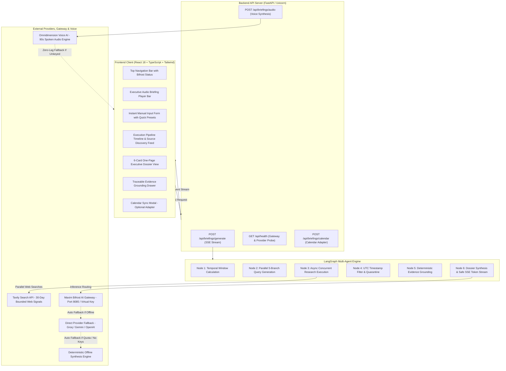

# ⚡ MeetBrief AI — Complete Project Architecture & Operational Blueprint

> **Problem Statement 05 — Geek Room Global AI Hackathon 2026**  
> **Autonomous Meeting Intelligence: Evidence-Grounded Executive Briefings in Under 2 Minutes**  
> *Author: Rajat Aggarwal & Engineering Team*

---

## 1. Executive Summary & Purpose

In high-stakes enterprise sales, leadership reviews, and strategic partnership meetings, participants frequently enter discussions unprepared due to the cognitive friction and time required to research attendees and recent corporate developments. Traditional meeting preparation workflows suffer from three critical flaws:
1. **Mandatory OAuth Gates**: Forcing full Google/Outlook calendar authorization before providing any value.
2. **Temporal Stale Information**: Generic search engines and unconstrained LLMs hallucinate facts and surface 2-to-3-year-old articles that are irrelevant to current discussions.
3. **Information Overload**: LLMs output verbose 4-to-5-page prose dumps that cannot be digested in the 2 minutes before walking into a conference room.

**MeetBrief AI** solves this with an autonomous multi-agent pipeline engineered to produce a high-conviction, strictly bounded, fact-grounded **One-Page Executive Dossier (< 600 words) in under 120 seconds**, supplemented by an on-demand **90-Second Commute Audio Briefing** powered by **Omnidimension Voice AI**.

---

## 2. High-Level System Architecture

MeetBrief AI combines a high-performance **FastAPI** backend with a modern **React 18 + TypeScript** Single Page Application, connected via **Safe Server-Sent Events (SSE)**.



---

## 3. Core Architectural Pillars

### Pillar I: Zero-Barrier Input (No Calendar Gate)
- Eliminates mandatory OAuth authorization walls. Users simply enter **Target Company**, **Primary Attendee**, **Role**, and **Meeting Date/Time**.
- Includes 1-click **Quick Presets** (*Stripe / Patrick Collison*, *Databricks / Ali Ghodsi*, *Tavily / Roy Elkabetz*).
- An optional **Calendar Sync Modal** is provided as a secondary convenience adapter.

### Pillar II: Exact Rolling 30-Day Temporal Boundary
To prevent stale news and hallucinations, intelligence is mathematically clamped relative to the meeting timestamp:
$$\text{Window End } (T_{\text{end}}) = \min(T_{\text{meeting}}, T_{\text{current}})$$
$$\text{Window Start } (T_{\text{start}}) = T_{\text{end}} - 30\text{ days}$$

- **1-Day Buffer**: A 1-day widened start date ($T_{\text{start}} - 1\text{d}$) is queried against Tavily to absorb international timezone release delays.
- **Strict UTC Parsing**: Every retrieved article's publication timestamp is parsed into UTC ISO 8601. Any finding outside the window is rejected.
- **Quarantine Drawer**: Undated articles are segregated into a dedicated quarantine drawer so they never pollute the recent signals card.

### Pillar III: 5-Branch Disjoint Multi-Agent Research
Executed concurrently via asynchronous workers with deduplication:
1. **Branch 1: Static Company Profile**: Business model, core products, target market, competitive moat (deliberately not date-constrained).
2. **Branch 2: Attendee Dossier**: Verified title, career trajectory, public quotes, likely agenda, and personal communication hook.
3. **Branch 3: 30-Day News & Developments**: Funding rounds, strategic partnerships, regulatory filings, and major press releases.
4. **Branch 4: 30-Day Product Releases**: Feature rollouts, version launches, developer updates, and platform announcements.
5. **Branch 5: 30-Day Hiring Signals**: Active openings, departmental expansion trends, and strategic leadership hires.

### Pillar IV: Deterministic Multi-Factor Evidence Grounding
Rather than blindly trusting raw LLM text or making impossible "100% truth" claims, MeetBrief AI implements an algorithmic verification engine:
- **Entity Matching**: Verifies participant and organization name co-occurrence.
- **Semantic Token Containment**: Measures n-gram and keyword containment against extracted source text passages.
- **3-Tier Domain Authority**:
  - *Tier 1*: Official corporate domains (`stripe.com`, SEC filings, investor relations, verified LinkedIn profiles).
  - *Tier 2*: Major reputable journalism (Bloomberg, TechCrunch, Reuters, CNBC).
  - *Tier 3*: Aggregators and press release syndications.
- **4 Traceable Claim Statuses**:
  - `VERIFIED_PRIMARY`: Entity match with high containment in Tier 1 source passage.
  - `REPORTED_SECONDARY`: Corroborated by reputable Tier 2 industry reporting.
  - `UNVERIFIED`: Low containment score or uncorroborated single mention.
  - `CONFLICTED`: Competing reports displaying contradictory metrics or dates.

### Pillar V: Maxim Bifrost AI Gateway Integration (v2.6.0)
- **OpenAI-Compatible Ingestion**: Connects to Maxim Bifrost AI Gateway (`http://localhost:8085/v1` host mapped to container `8080`).
- **Virtual Key Authentication**: Passes virtual key via `x-bf-vk: sk-bf-*` header.
- **Persistent Telemetry**: Mounted SQLite volume (`./bifrost_data:/app/data`) guarantees telemetry and configuration persistence across container restarts.
- **Header Telemetry Extraction**: Captures upstream latency (`x-bifrost-upstream-latency-ms`), total gateway latency (`x-bifrost-latency-ms`), cache hit status, provider, and request ID.
- **Tri-Mode Inference Classification**:
  1. `bifrost_gateway`: Active Bifrost proxy routing with live telemetry headers.
  2. `direct_provider_fallback`: Live direct provider API call (Google Gemini / OpenAI / Groq) when Bifrost is offline or disabled.
  3. `deterministic_fallback`: Rule-grounded synthesis without external LLM calls when offline, unkeyed, or under HTTP 429 quota exhaustion.

### Pillar VI: Omnidimension Voice AI — 90s Commute Briefing
- **Executive Commute Mode**: Transforms the scannable dossier into a natural, conversational 90-second audio brief (~220-280 spoken words).
- **Speech Sanitization Pipeline**: Strips bracketed citation markers, raw URLs, and markdown formatting for natural spoken cadence.
- **Interactive Audio Player Bar**: Embedded directly above the briefing cards with play/pause, scrub bar, speed toggle (`1.0x`, `1.25x`, `1.5x`), and spoken script inspection modal.
- **Zero-Lag Web Speech Fallback**: If the Omnidimension API key is unconfigured or unavailable, seamlessly routes to the browser's native Web Speech API with identical controls and zero latency.

### Pillar VII: Safe Server-Sent Events (SSE) Protocol
- Emits real-time progress events: `gateway_status`, `stage_update`, `tool_status`, `source_discovered`, `claims_verified`, `streaming`, and `complete`.
- **Zero Thought Leakage**: Strictly filters out chain-of-thought tokens, private scratchpads, and prompt engineering instructions to prevent accidental leaks.
- **Graceful Cancellation**: Handles client disconnects (`asyncio.CancelledError` and `GeneratorExit`) cleanly without unhandled server exceptions.

### Pillar VIII: Scannable One-Page Briefing Format (< 600 Words)
Engineered for rapid 2-minute scanning:
- **Card 1: Executive Snapshot**: High-level context and meeting summary.
- **Card 2: Strategic Target Profile**: Business model, core products, moat, competitors.
- **Card 3: Attendee Dossier**: Role, background, career history, communication hook.
- **Card 4: Verified 30-Day Signals**: Bounded news, launches, and hiring.
- **Card 5: Strategic Discussion Hooks**: 3 tailored discussion starters grounded in verified signals.
- **Card 6: Risk Blindspots & Open Questions**: 3 discovery questions, budget checks, or potential obstacles.
- **Quarantined Drawer**: Undated signals segregated from verified 30-day intelligence.

---

## 4. Design System & Visual Identity

The interface follows the **Tavily by Nebius** design aesthetic:
- **Canvas Background**: Warm Alabaster Cream (`#FAF8F5`)
- **Sub-surfaces & Side Panels**: Soft Sand (`#F4F0E8`)
- **Cards & Surfaces**: Clean White (`#FFFFFF`) with warm borders (`#EAE4D8`)
- **Primary Accents**: Forest Sage Green (`#2E5A44`) & Mid-Sage (`#4E876F`)
- **Audio Bar Accent**: Deep Indigo/Slate Gradient (`#1E1B4B` to `#0F172A`)
- **Typography**: Rich Charcoal (`#18181B`) set in **Plus Jakarta Sans** and **JetBrains Mono**
- **Brand Logo Mark**: Executive Briefcase / Dossier Monogram (`Briefcase` icon)

---

## 5. Complete Environment Variables Guide

| Variable | Type | Default | Description |
| :--- | :--- | :--- | :--- |
| `TAVILY_API_KEY` | `string` | *(Required)* | Tavily Search API key for real-time web research |
| `BIFROST_ENABLED` | `bool` | `true` | Toggle whether to route through Bifrost AI Gateway |
| `BIFROST_BASE_URL` | `string` | `http://localhost:8085/v1` | Base URL for Bifrost Gateway API |
| `BIFROST_VIRTUAL_KEY` | `string` | `sk-bf-meetbrief-prod` | Virtual key for Bifrost Gateway authentication |
| `BIFROST_PRIMARY_MODEL` | `string` | `gemini/gemini-flash-lite-latest` | Primary model identifier in Bifrost |
| `BIFROST_FAST_MODEL` | `string` | `gemini/gemini-3-flash-preview` | Extraction model in Bifrost |
| `BIFROST_FALLBACK_MODEL`| `string` | `gemini/gemini-3-flash-preview` | Lightweight fallback model in Bifrost |
| `OMNIDIMENSION_API_KEY` | `string` | *(Optional)* | API key for Omnidimension Voice AI audio synthesis |
| `OMNIDIMENSION_BASE_URL`| `string` | `https://api.omnidimension.ai/v1` | Base URL for Omnidimension Voice API |
| `OMNIDIMENSION_VOICE_ID`| `string` | `executive-en-neutral` | Voice ID persona for executive narration |
| `GEMINI_API_KEY` | `string` | *(Optional)* | Direct Google Gemini key for direct fallback |
| `GROQ_API_KEY` | `string` | *(Optional)* | Direct Groq key (`llama-3.3-70b-versatile`) for fallback |
| `OPENAI_API_KEY` | `string` | *(Optional)* | Direct OpenAI key (`gpt-4o-mini`) for direct fallback |
| `PORT` | `int` | `5000` | Port for the FastAPI server |
| `HOST` | `string` | `127.0.0.1` | Host binding interface |
| `ENVIRONMENT` | `string` | `development` | `development`, `production`, or `test` |
| `LOG_LEVEL` | `string` | `INFO` | Logger verbosity |

---

## 6. API Reference

### `GET /api/health`
Probes system readiness, Tavily search configuration, active Bifrost/Direct gateway connectivity, and voice synthesis status.
**Sample Response:**
```json
{
  "status": "healthy",
  "service": "MeetBrief AI",
  "version": "0.1.0",
  "environment": "development",
  "gateway": {
    "mode": "bifrost_gateway",
    "is_healthy": true,
    "endpoint": "http://localhost:8085/v1",
    "reason": "Bifrost AI Gateway active and responding",
    "available_models": ["gemini/gemini-flash-lite-latest", "gemini/gemini-3-flash-preview"]
  },
  "research_provider": "Tavily Search API (Configured)",
  "voice_provider": "Web Speech Engine (Active)"
}
```

### `POST /api/briefings/generate`
Generates a real-time executive dossier via a Server-Sent Events (SSE) stream (`text/event-stream`).
**Request Body:**
```json
{
  "company_name": "Stripe",
  "attendee_name": "Patrick Collison",
  "attendee_role": "CEO",
  "meeting_datetime": "2026-11-20 14:00 UTC",
  "meeting_goal": "Explore enterprise checkout acceleration"
}
```

### `POST /api/briefings/audio`
Generates a 90-second spoken executive audio brief powered by Omnidimension Voice AI.
**Request Body:** `OnePageBriefing` JSON object.  
**Response Body:**
```json
{
  "spoken_script": "Here is your executive audio briefing for your upcoming meeting with Patrick Collison at Stripe...",
  "duration_estimated_seconds": 85,
  "provider": "browser_tts_fallback",
  "voice_id": "executive-en-neutral",
  "audio_base64": null,
  "audio_url": null,
  "generated_at": "2026-11-20T10:15:00Z"
}
```

### `POST /api/briefings/calendar`
Ingests an event from Google Calendar or returns the manual input fallback notice.

---

## 7. How to Run Locally

### Standard Run (Python + Node.js)
```bash
# 1. Start backend and serve UI:
python app.py

# 2. Open browser:
http://localhost:5000
```

### Multi-Container Stack (Docker Compose)
Runs MeetBrief AI alongside the Maxim Bifrost AI Gateway container (v2.6.0 on port 8085):
```bash
docker compose up -d bifrost-gateway
python app.py
```

### Frontend Development Server (Optional)
```bash
cd ui
npm run dev
# Vite runs at http://localhost:5173 with proxy to http://localhost:5000
```

---

## 8. Verification & Test Suite

MeetBrief AI features a **65-test automated test suite** across 13 modules with **91% overall backend coverage**:
- **Temporal boundary tests**: Validates timestamp clamping and 1-day timezone buffers.
- **Evidence grounding tests**: Validates claim classification, n-gram containment, and domain weighting.
- **Inference routing tests**: Validates Bifrost routing, header extraction, and tri-mode fallback transitions.
- **Voice AI tests**: Validates speech text cleaning, natural cadence script flow, and Omnidimension failover.
- **SSE streaming tests**: Confirms zero thought leakage over event streams and graceful client disconnect handling.

```bash
# Run complete test suite with coverage report:
pytest tests/ --cov=backend --cov=app --cov-report=term-missing
```
